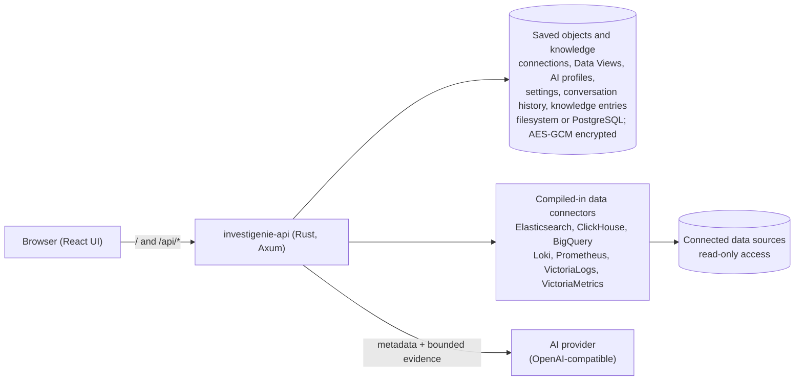

# Architecture

InvestiGenie is one Rust server that serves a React app and a JSON API. Datasources are compiled-in integrations; everything you configure is stored encrypted.

## Building blocks

| Part | Where | Role |
|---|---|---|
| Web UI | `frontend/` | Explore, Data Views, Connections, AI Models, Knowledge, InvestiGenie AI. Built to static files. |
| API server | `backend/` | Routes, storage, AI investigations, and serving the built UI on the same address. |
| Data connectors | `integrations/data_connectors/<id>/` | One folder per datasource. Discovered at build time; existing IDs remain unchanged. |
| AI connectors | `integrations/ai_connectors/` | Concrete transports only. `openai/` implements OpenAI-compatible Chat Completions. |
| Connector contracts | `backend/src/data_connectors.rs`, `backend/src/ai_connectors.rs` | Shared interfaces, types, and registration owned by the backend. |
| Storage | `backend/src/storage*` | Connections, Data Views, AI model profiles, settings, AI conversation history, and knowledge entries. Encrypted, with revisions. |

## Core concepts

- **Connection:** how to reach one datasource (URL plus credentials). Secrets never leave the server.
- **Data View:** a named connection + index/table + time field. Explore and AI work only on Data Views.
- **Integration:** the code that talks to a datasource type and describes its UI (form fields, query language, capabilities).
- **AI connector:** provider transport only: authentication, HTTP limits, completion decoding, usage, and protocol-specific fallbacks. Metadata planning, bounded evidence queries, direct answers to the latest user request, hypothesis generation, JSON repair, evidence validation, job control, and history remain in the backend.
- **AI model profile:** an OpenAI-compatible endpoint, model, and key, chosen per investigation.
- **Knowledge entry:** scoped service context, a runbook, or an incident write-up. It is manually managed or explicitly copied from a completed investigation as an unverified draft. Publication is not verification; investigations do not retrieve entries yet.

`backend/src/data_connectors.rs` owns the datasource `Connector` contract, metadata/configuration helpers, and generated registry; implementations import `crate::data_connectors`. `backend/src/ai_connectors.rs` owns `AiConnector`, `AiSettings`, `ProviderReply`, `ModelUsage`, sanitized `AiConnectorError`, and `default_connector()`, and declares concrete transport modules with explicit paths. The default is OpenAI-compatible; saved model/connection schemas and API payloads have not changed. New harness transports implement the shared completion interface and are registered explicitly in the backend contract module. There is no runtime plugin loader or AI connector selector yet. "OpenAI-compatible" describes the supported Chat Completions protocol, not every endpoint in OpenAI's API.

## Request flows

**Explore search:** UI → `POST /api/connections/{id}/search` → the integration runs the query with the time window, sort, and paging → documents plus a histogram (interval, optional breakdown) → UI.

**AI investigation:** UI starts a background job → request routing returns ordinary conversation directly without playbook/evidence searches, or sends a data request through metadata planning → the evidence engine issues bounded source queries → the AI answers the request directly from current evidence and forms cited hypotheses → optionally, one metadata-validated follow-up query can update the answer → the UI polls the job and can continue or stop it at check-ins.

The investigation pipeline runs published Knowledge Playbook aggregations across selected Data Views before metadata planning, then uses bounded sample queries and source aggregations for hypotheses. New investigations can opt into one additional validated query; it is disabled by default and cannot supply raw connector query text. Other Knowledge entries remain manually managed and encrypted in either persistence mode; they are not retrieved into investigations. AI conversation history has configurable day-based retention. See [AI Investigation Pipeline](investigation-pipeline.md) for the implemented stages and limits.

**AI history:** each investigation scope, user turn, and result are persisted in encrypted storage. Users can reopen, delete, or continue a scoped conversation; each investigative turn reuses its Data Views/time range and runs fresh bounded evidence, with prior turns supplied as untrusted context. Legacy scope-less conversations retain text-only replies. One top-level action saves the complete session as a Knowledge draft.

**Knowledge management:** UI creates/lists entries through `/api/knowledge` and reads/updates/deletes through `/api/knowledge/{id}`. Existing entries require the current quoted `If-Match` revision for mutations. A completed conversation can be explicitly copied, with all turns and results, into one unverified draft; **Review draft** opens the saved entry in the editor. No model call, automatic save, or publication is triggered by this copy. Only published Investigation Playbooks feed preflight. See the [knowledge lifecycle](investigation-pipeline.md#knowledge-lifecycle-implemented).

## Design rules

- **Datasources are read-only:** ClickHouse runs with `readonly=1`, and Elasticsearch only searches.
- **Bounded everything:** page sizes (≤100), timeouts, concurrency (64 upstream calls, 4 AI jobs), and request/response sizes.
- **No credentials to the browser or the AI:** connection secrets stay in encrypted storage.
- **No built-in login yet:** run it locally, or behind an authenticated gateway.
- **The UI follows integration metadata:** new datasources need no UI changes unless they add a new capability.

## Deployment shapes

| Shape | Storage | Notes |
|---|---|---|
| Release zip / single binary | Filesystem (quickstart by default) | One process serves UI + API on port 3000. |
| Docker (`ghcr.io/investigenie/investigenie`) | Filesystem in the `/data` volume | amd64 + arm64, non-root, health check built in. Registry access depends on package visibility and pull permissions. |
| Multiple replicas | PostgreSQL | Run `investigenie-api migrate` once per schema change. AI jobs are per-replica (in memory). |
