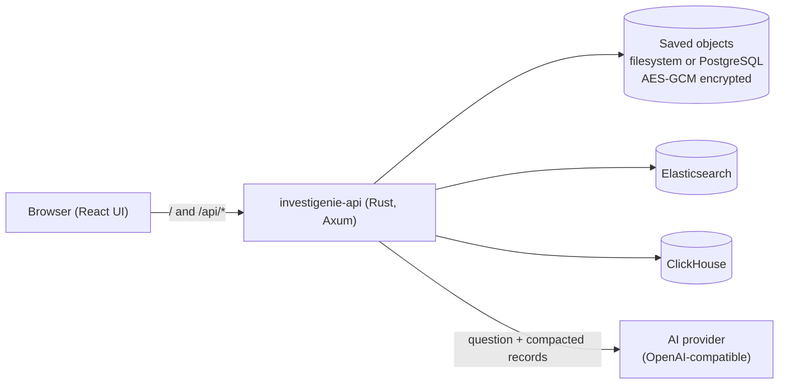

# Architecture

InvestiGenie is one Rust server that serves a React app and a JSON API. Datasources are compiled-in integrations; everything you configure is stored encrypted.

## Building blocks

| Part | Where | Role |
|---|---|---|
| Web UI | `frontend/` | Explore, Data Views, Connections, AI Models, InvestiGenie AI. Built to static files. |
| API server | `backend/` | Routes, storage, AI investigations, and serving the built UI on the same address. |
| Integrations | `integrations/<id>/` | One folder per datasource. Discovered at build time. |
| Storage | `backend/src/storage*` | Connections, Data Views, AI model profiles, settings. Encrypted, with revisions. |

## Core concepts

- **Connection:** how to reach one datasource (URL plus credentials). Secrets never leave the server.
- **Data View:** a named connection + index/table + time field. Explore and AI work only on Data Views.
- **Integration:** the code that talks to a datasource type and describes its UI (form fields, query language, capabilities).
- **AI model profile:** an OpenAI-compatible endpoint, model, and key, chosen per investigation.

## Request flows

**Explore search:** UI → `POST /api/connections/{id}/search` → the integration runs the query with the time window, sort, and paging → documents plus a histogram (interval, optional breakdown) → UI.

**AI investigation:** UI starts a background job → the AI plans filters for the selected Data Views → the server scans every matching record in 100-record pages → records are compacted and grouped by signal → the AI analyses batches into a rolling set of findings → the UI polls the job and can continue or stop it at check-ins.

## Design rules

- **Datasources are read-only:** ClickHouse runs with `readonly=1`, and Elasticsearch only searches.
- **Bounded everything:** page sizes (≤100), timeouts, concurrency (64 upstream calls, 4 AI jobs), and request/response sizes.
- **No credentials to the browser or the AI:** connection secrets stay in encrypted storage.
- **No built-in login yet:** run it locally, or behind an authenticated gateway.
- **The UI follows integration metadata:** new datasources need no UI changes unless they add a new capability.

## Deployment shapes

| Shape | Storage | Notes |
|---|---|---|
| Release zip / single binary | Filesystem (quickstart by default) | One process serves UI + API on port 3000. |
| Docker (`ghcr.io/investigenie/investigenie`) | Filesystem in the `/data` volume | amd64 + arm64, non-root, health check built in. |
| Multiple replicas | PostgreSQL | Run `investigenie-api migrate` once per schema change. AI jobs are per-replica (in memory). |
