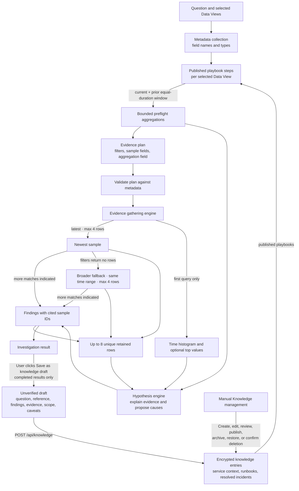
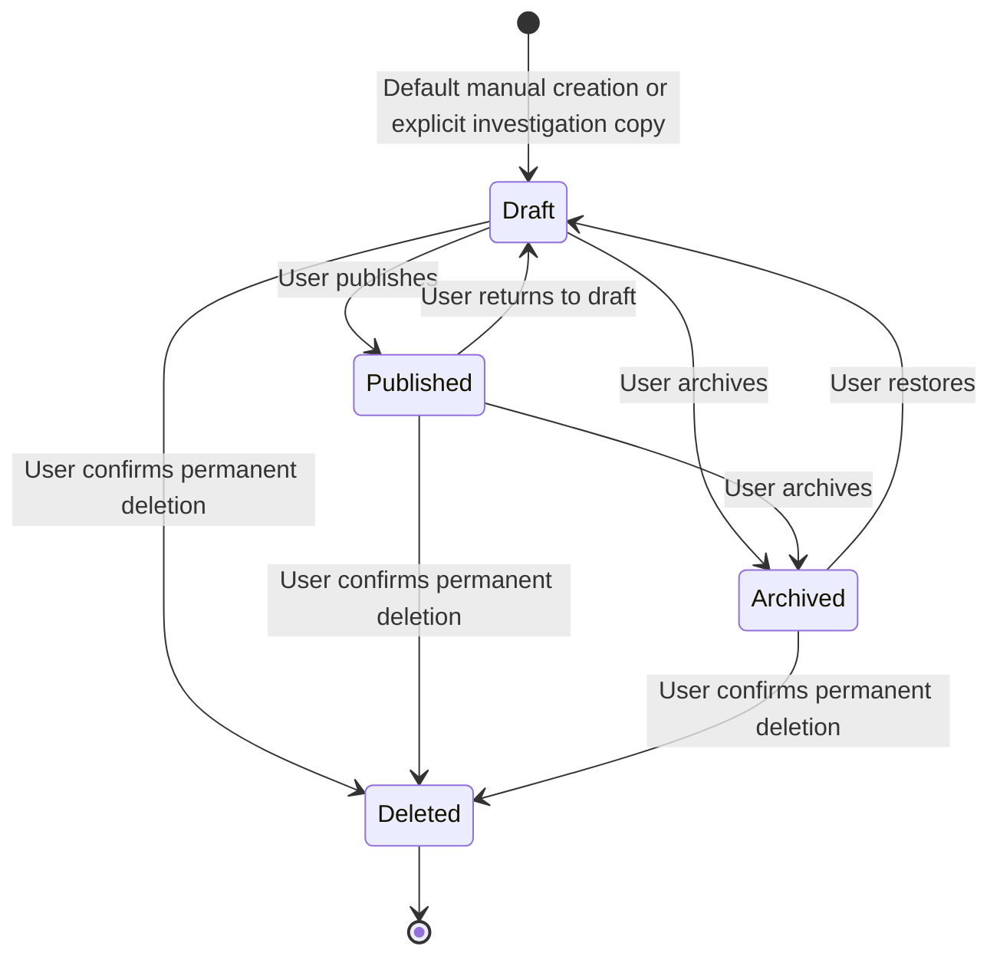

# AI Investigation Pipeline

The investigation planner receives Data View metadata, not a dump of source records. A bounded evidence engine validates the plan, runs datasource queries, and sends only compact samples and aggregations to hypothesis generation. Connection credentials stay on the server.

Solid arrows show implemented flows. Only published Investigation Playbooks execute; other Knowledge types remain curated references. A completed investigation does not save a Knowledge entry unless the user clicks the save action, and saving a draft does not publish it.

## Boundaries

- Planning uses Data View names, indices, field names, and field types. It returns candidate filters, a bounded list of sample fields, and an optional aggregation field.
- Before planning, each applicable published playbook step runs against selected Data Views through the existing read-only connector search. A step specifies an optional connector-native query and breakdown field; the backend bounds execution and checks breakdown fields against live metadata. For a bounded window, the same step runs over the immediately preceding equal-duration inclusive window; All time has no baseline. The result exposes the query, both scopes, aggregate counts/buckets, and failures. Query text and labels are untrusted evidence, never model instructions.
- The evidence engine validates those choices and runs at most three bounded sample queries per Data View: latest rows, earliest rows if additional matches are indicated, and a broader query within the same time range if filters return no rows. Each query returns at most four records; at most eight unique sample rows per Data View are retained. The first query may also request a source-side histogram and top-value breakdown (up to three values plus `__other__` per bucket), which can cover more records than the sample. AI Elasticsearch requests disable exact hit counting. Sample records include at most four selected fields, values are capped at 256 bytes, and the hypothesis payload keeps at most 16 aggregate buckets. Timed-out source searches fail the investigation. The result reports sampled rows, compact records actually supplied to the model, aggregation totals, and each query scope separately. It does not page through every matching record.
- Hypothesis generation receives the question, validated scope, per-query coverage, aggregate summaries, and compact sample evidence. Findings without valid sample citations are removed; finding counts are derived from distinct cited sample IDs, never copied from a whole-query aggregate. Empty results are reported as insufficient sampled evidence, not an all-clear. Confidence remains model judgment and conclusions are never marked verified automatically. Valid citations establish traceability only; they do not establish that an inferred cause is correct or immune to misleading source text.
- Knowledge storage contains manual reference entries and structured Investigation Playbooks. A published, editable default playbook is seeded once; user playbooks use revision-checked edits and archive/restore. Only published playbooks feed preflight; other Knowledge entries are not retrieved. Completed live/history results can be explicitly copied into unverified drafts. Publishing remains an editorial decision, not proof of correctness.
- AI conversation history is separate from Knowledge, encrypted in either storage mode, and retained for 30 days by default (configurable from 1 to 3650). Expired completed records are pruned on startup, history list/read, create/append, and retention changes. Active conversations are preserved at runtime; stale interrupted jobs are pruned after restart. Saving a result to Knowledge preserves it beyond history expiry.

## Knowledge lifecycle (implemented)

This diagram shows the quick actions; the editor also permits explicitly selecting a status. Every saved edit generates a new revision. Updates and deletes require the current revision; a stale write returns a conflict without overwriting the entry. Archived entries remain editable and restorable. The built-in default playbook can be archived but cannot be permanently deleted. Other entries are permanently deleted on confirmation; no version-history browser or automatic recovery is implied.

**Save as knowledge draft** is available on completed live results and completed results reopened from AI history. Running, paused, terminated, failed, and explicitly incomplete results cannot be saved through that action. It copies existing data without another AI request and leaves cause/resolution marked unconfirmed. The original question is used for the bounded title; source Data View IDs are preserved, but service/environment labels are left for the reviewer rather than guessed. UTF-8-safe truncation is disclosed when the content or serialized request would exceed its limit.

**Review knowledge draft** navigates to the saved entry for editing. The user must publish it separately. Publication records the editorial choice, not proof of the investigation's conclusions. A saved resolved-incident draft does not become an executable Playbook unless the user changes its kind and defines steps.

## Future Knowledge Extensions

The knowledge base is intended to make investigations more repeatable, not to replace current evidence:

- Build on manually curated service context, runbooks, and resolved incidents. Preserve source/scope context and distinguish publication from verification. Future citations must retain the entry title, revision, and excerpt used even after an entry changes or is deleted.
- Future retrieval of non-playbook reference entries may suggest filters, queries, or known cases. Each investigation must still recheck current connected data and cite evidence from that run; never present a stored solution as a current finding by itself.
- Route known patterns through deterministic queries and decision steps where possible, including a visible baseline and evidence gates. Keep the bounded hypothesis path for unknown cases, and allow an explicit insufficient-evidence result rather than forcing a cause.
- Distinguish observed evidence from inferred causal links and proposed explanations; retain relevant blind spots and missing telemetry in the result.
- Record outcomes such as confirmed resolutions, dismissed hypotheses, false positives, and proposed actions as reviewable history. Feedback may suggest a KB or rule revision, but must not silently change verified knowledge. Promote a solution only after an explicit verification signal; validate detection changes against both benign and malicious examples.
- Evaluate deterministic and model-assisted paths on the same regression cases. Compare evidence validity and investigation quality alongside latency and cost, per task, rather than relying on an unverified headline speed claim.
- Defer continuous streaming ingestion and an external MCP interface until a concrete workflow requires them. MCP exposure additionally requires authentication and per-caller authorization.
