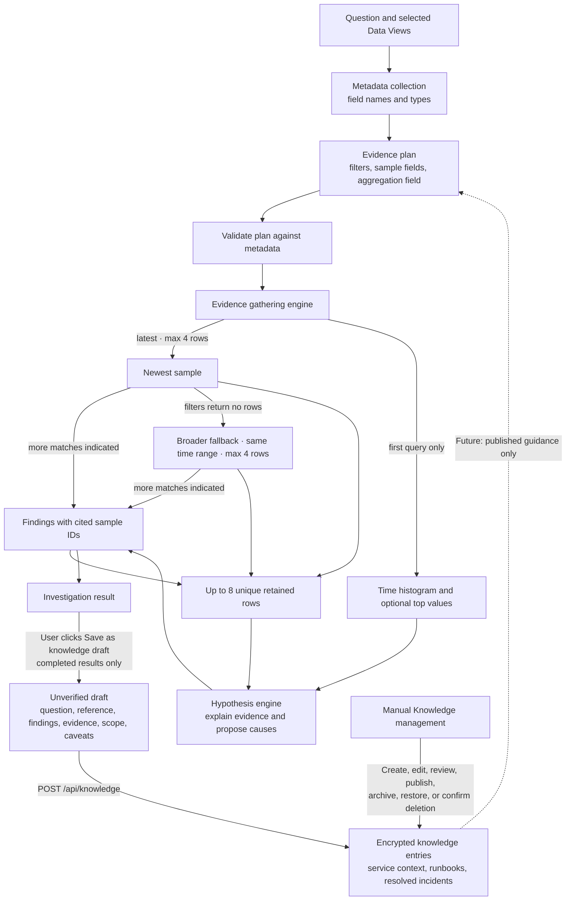
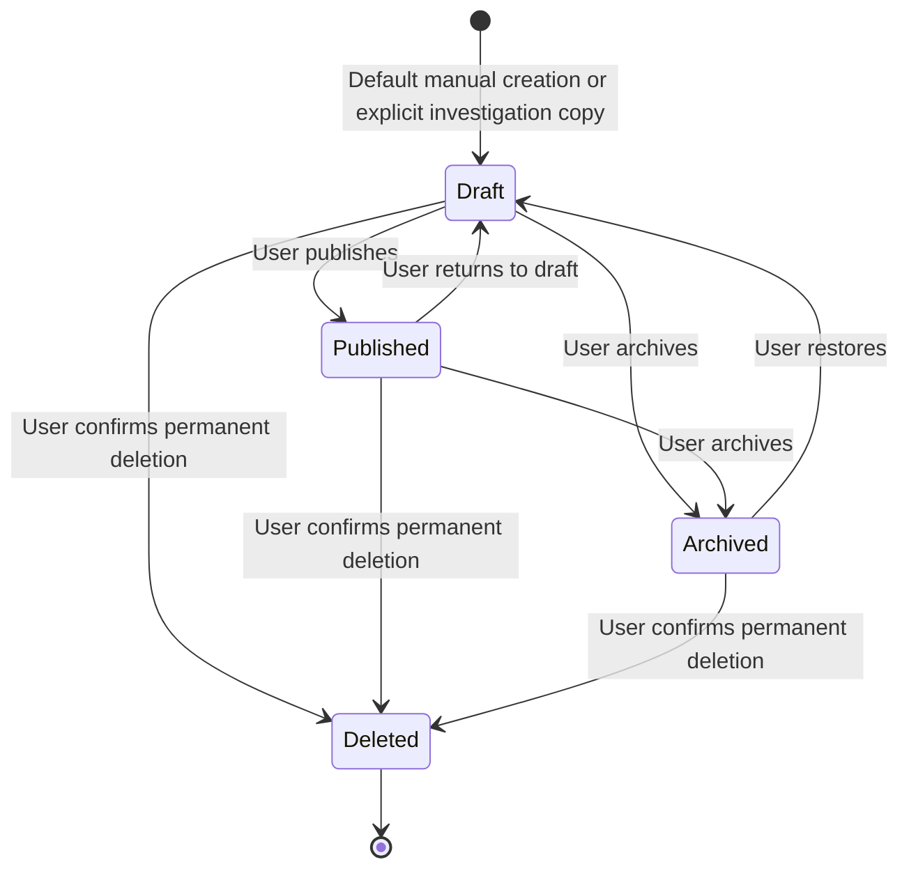

# AI Investigation Pipeline

The investigation planner receives Data View metadata, not a dump of source records. A bounded evidence engine validates the plan, runs datasource queries, and sends only compact samples and aggregations to hypothesis generation. Connection credentials stay on the server.

Solid arrows show implemented flows. The dotted retrieval arrow is planned, not active. A completed investigation does not save knowledge unless the user clicks the save action, and saving a draft does not publish it.

## Boundaries

- Planning uses Data View names, indices, field names, and field types. It returns candidate filters, a bounded list of sample fields, and an optional aggregation field.
- The evidence engine validates those choices and runs at most three bounded sample queries per Data View: latest rows, earliest rows if additional matches are indicated, and a broader query within the same time range if filters return no rows. Each query returns at most four records; at most eight unique sample rows per Data View are retained. The first query may also request a source-side histogram and top-value breakdown (up to three values plus `__other__` per bucket), which can cover more records than the sample. AI Elasticsearch requests disable exact hit counting. Sample records include at most four selected fields, values are capped at 256 bytes, and the hypothesis payload keeps at most 16 aggregate buckets. Timed-out source searches fail the investigation. The result reports sampled rows, compact records actually supplied to the model, aggregation totals, and each query scope separately. It does not page through every matching record.
- Hypothesis generation receives the question, validated scope, per-query coverage, aggregate summaries, and compact sample evidence. Findings without valid sample citations are removed; finding counts are derived from distinct cited sample IDs, never copied from a whole-query aggregate. Empty results are reported as insufficient sampled evidence, not an all-clear. Confidence remains model judgment and conclusions are never marked verified automatically. Valid citations establish traceability only; they do not establish that an inferred cause is correct or immune to misleading source text.
- Manual knowledge storage and management are implemented, with draft/published/archived status and revision-checked edits. Completed live/history results can be explicitly copied into unverified drafts with their investigation reference and evidence scope, then reviewed in the Knowledge editor. Publishing is an editorial decision, not proof of correctness. Automatic entry creation, retrieval, and investigation citation snapshots remain future work; investigations currently run without knowledge entries.

## Knowledge lifecycle (implemented)

This diagram shows the quick actions; the editor also permits explicitly selecting a status. Every saved edit generates a new revision. Updates and deletes require the current revision; a stale write returns a conflict without overwriting the entry. Archived entries remain editable and restorable. Permanent deletion removes the entry, so no version-history browser or automatic recovery is implied.

**Save as knowledge draft** is available on completed live results and completed results reopened from AI history. Running, paused, terminated, failed, and explicitly incomplete results cannot be saved through that action. It copies existing data without another AI request and leaves cause/resolution marked unconfirmed. The original question is used for the bounded title; source Data View IDs are preserved, but service/environment labels are left for the reviewer rather than guessed. UTF-8-safe truncation is disclosed when the content or serialized request would exceed its limit.

**Review knowledge draft** navigates to the saved entry for editing. The user must publish it separately. Publication only records the user's editorial choice; it does not prove the investigation's conclusions and does not enable retrieval in the current release.

## Future Knowledge and Investigation Behavior

The knowledge base is intended to make investigations more repeatable, not to replace current evidence:

- Build on manually curated service context, runbooks, and resolved incidents. Preserve source/scope context and distinguish publication from verification. Future citations must retain the entry title, revision, and excerpt used even after an entry changes or is deleted.
- Retrieve entries as candidate guidance for planning. A match may suggest filters, queries, or a known-case workflow, but each investigation must recheck the current connected data and cite evidence from that run. Never present a stored solution as a current finding by itself.
- Route known patterns through deterministic queries and decision steps where possible, including a visible baseline and evidence gates. Keep the bounded hypothesis path for unknown cases, and allow an explicit insufficient-evidence result rather than forcing a cause.
- Distinguish observed evidence from inferred causal links and proposed explanations; retain relevant blind spots and missing telemetry in the result.
- Record outcomes such as confirmed resolutions, dismissed hypotheses, false positives, and proposed actions as reviewable history. Feedback may suggest a KB or rule revision, but must not silently change verified knowledge. Promote a solution only after an explicit verification signal; validate detection changes against both benign and malicious examples.
- Evaluate deterministic and model-assisted paths on the same regression cases. Compare evidence validity and investigation quality alongside latency and cost, per task, rather than relying on an unverified headline speed claim.
- Defer continuous streaming ingestion and an external MCP interface until a concrete workflow requires them. MCP exposure additionally requires authentication and per-caller authorization.
