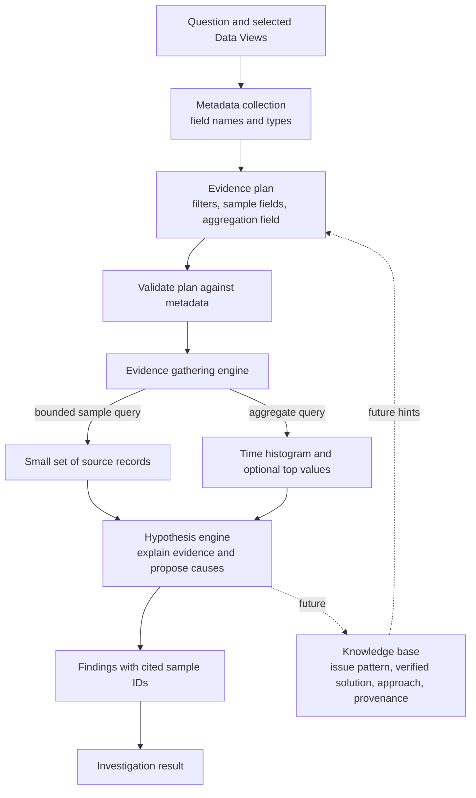

# AI Investigation Pipeline

The investigation planner receives Data View metadata, not a dump of source records. A bounded evidence engine validates the plan, runs datasource queries, and sends only compact samples and aggregations to hypothesis generation. Connection credentials stay on the server.

## Boundaries

- Planning uses Data View names, indices, field names, and field types. It returns candidate filters, a bounded list of sample fields, and an optional aggregation field.
- The evidence engine validates those choices and sends one bounded search request per selected Data View for at most four records plus a time histogram. Adapters may make additional database-side aggregation/preflight requests. AI Elasticsearch requests disable exact hit counting. The result can include one top-value breakdown (up to three values plus `__other__` per bucket) when supported. Sample records include at most four selected fields, values are capped at 256 bytes, and the hypothesis payload keeps at most 16 histogram buckets. It does not page through every matching record.
- Hypothesis generation receives the question, validated scope, aggregate summaries, and compact sample evidence. Findings may cite only IDs included in those samples.
- Knowledge-base storage and retrieval are future work. The intended record is the issue pattern, its verified solution, and the approach that found it; nothing is persisted by this stage yet.

## Future Knowledge and Investigation Behavior

The knowledge base is intended to make investigations more repeatable, not to replace current evidence:

- Store reusable issue patterns, verified solutions, and the investigation approach that found them. Preserve enough source/scope context, evidence provenance, verification status, and revision/freshness information to identify when a result is stale or not yet verified.
- Retrieve entries as candidate guidance for planning. A match may suggest filters, queries, or a known-case workflow, but each investigation must recheck the current connected data and cite evidence from that run. Never present a stored solution as a current finding by itself.
- Route known patterns through deterministic queries and decision steps where possible, including a visible baseline and evidence gates. Keep the bounded hypothesis path for unknown cases, and allow an explicit insufficient-evidence result rather than forcing a cause.
- Distinguish observed evidence from inferred causal links and proposed explanations; retain relevant blind spots and missing telemetry in the result.
- Record outcomes such as confirmed resolutions, dismissed hypotheses, false positives, and proposed actions as reviewable history. Feedback may suggest a KB or rule revision, but must not silently change verified knowledge. Promote a solution only after an explicit verification signal; validate detection changes against both benign and malicious examples.
- Evaluate deterministic and model-assisted paths on the same regression cases. Compare evidence validity and investigation quality alongside latency and cost, per task, rather than relying on an unverified headline speed claim.
- Defer continuous streaming ingestion and an external MCP interface until a concrete workflow requires them. MCP exposure additionally requires authentication and per-caller authorization.
